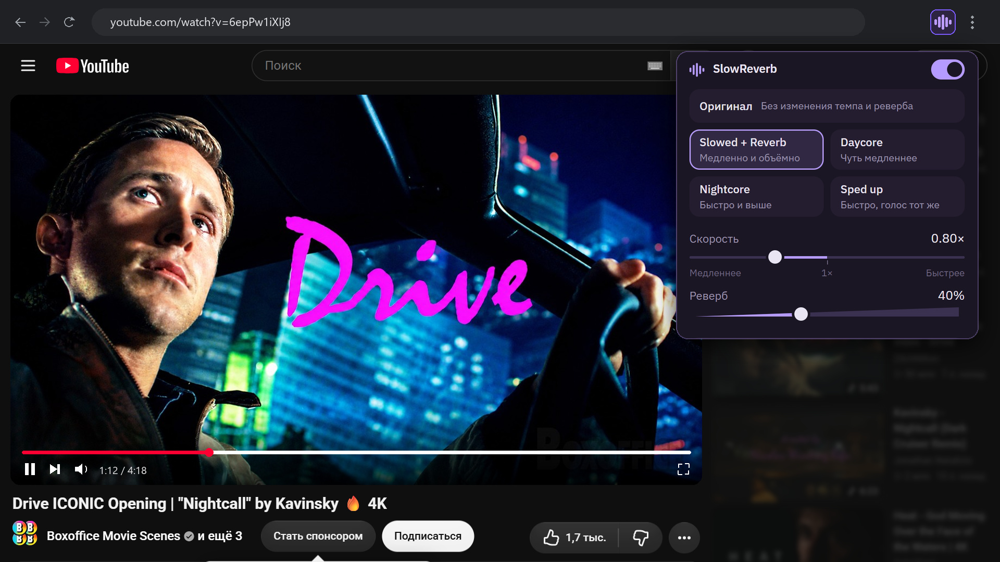

# SlowReverb — Real-Time Slowed + Reverb for Chrome

**Transform any track on YouTube, YouTube Music, Spotify Web, SoundCloud, and other web players into Slowed + Reverb, Daycore, Nightcore, Sped Up, or 8D audio in real time.**

 

---

## Why SlowReverb?

If you listen to *slowed + reverb* or *nightcore* edits on YouTube, you've probably seen your favorite playlists disappear due to copyright takedowns. And using YouTube's built-in `0.75x` speed doesn't work — it locks pitch (`preservesPitch = true`) and introduces metallic artifacts on vocals.

**SlowReverb** disables pitch preservation so the pitch drops naturally like tape or vinyl, then routes the live audio stream through a local **Web Audio API** processing graph.

## Features

- **One-Click Presets:** `Slowed + Reverb`, `Daycore`, `Nightcore`, `Sped up`, plus manual speed and reverb sliders.
- **Studio Mode:** Multiple reverb room styles, bass control, **8D stereo panning** for headphones, and optional **rain** & **vinyl crackle** ambient layers.
- **Custom Presets:** Save and reuse your favorite combinations.
- **Multi-Platform:** Works on YouTube, YouTube Music, Spotify Web, SoundCloud, Yandex Music, and other web players.
- **100% Local & Private:** All audio processing happens inside your browser tab. No backend, no accounts, no tracking.
- **16 Languages Supported:** Full localization across Chrome Web Store locales.
- **Standalone Web Player:** Process local audio files and export directly to **WAV** at [slowreverb.ru/en](https://slowreverb.ru/en/).

## Installation

1. Open the **[SlowReverb page on the Chrome Web Store](https://chromewebstore.google.com/detail/mafcpalbdcilppmmmneloeikgmibhnok?hl=en)**.
2. Click **Add to Chrome**.
3. Open any track on YouTube, Spotify Web, or SoundCloud, click the **SlowReverb** icon, and pick a preset.

## Feedback & Bug Reports

This repository serves as the official landing page and issue tracker for SlowReverb.

- Found a bug on a specific web player? **[Open an Issue](../../issues)**
- Want to request Firefox support, keyboard shortcuts, or a new reverb preset? Drop it in Issues!
